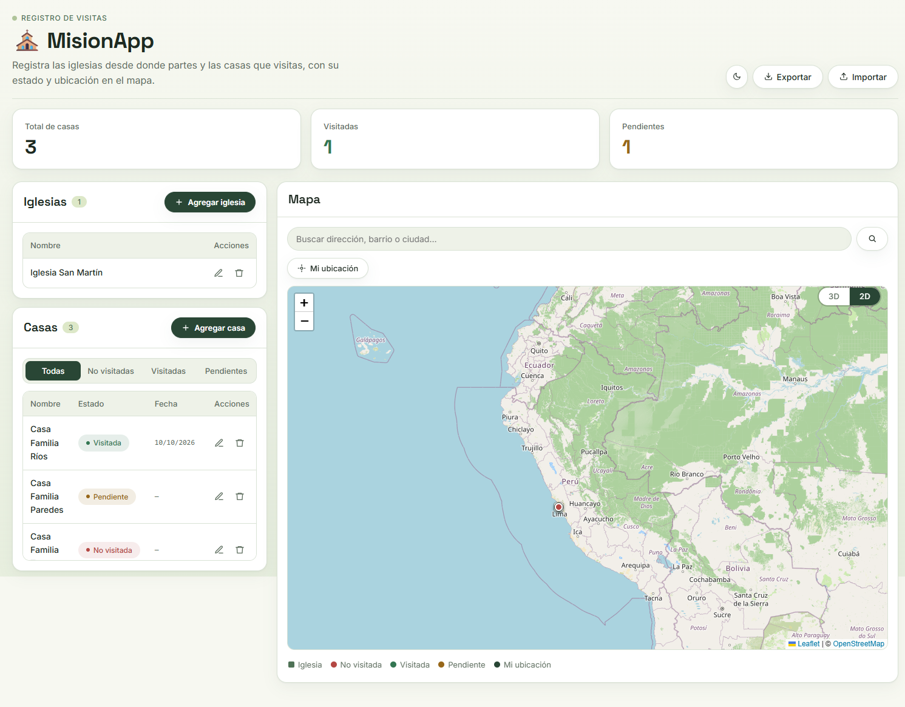
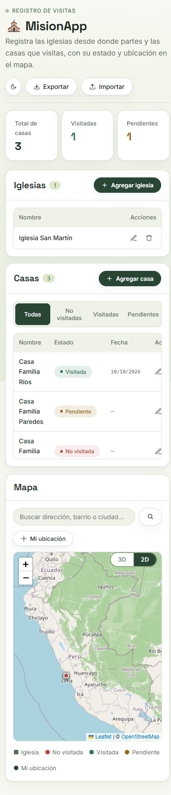

# MisionApp — registro de visitas de iglesias y casas en mapa

> App estática sin build que registra iglesias de partida y casas visitadas, con estado, fecha y marcadores sobre Leaflet.

[](https://github.com/TeVerde29/Mision)
[](index.html)
[](https://cdnjs.cloudflare.com/ajax/libs/leaflet/1.9.4/leaflet.min.js)
[](app.js)

## Capturas

| Escritorio | Mapa y tablas |
|---|---|
|  |  |

| Móvil |
|---|
|  |

Los misioneros registran iglesias y casas desde el mapa. Los coordinadores filtran por estado (no visitada, visitada, pendiente), revisan los contadores y exportan o importan el JSON para respaldo.

## Tabla de contenidos

- [Descripción](#descripción)
- [Repositorio](#repositorio)
- [Características principales](#características-principales)
- [Stack tecnológico](#stack-tecnológico)
- [Arquitectura](#arquitectura)
- [Instalación y uso](#instalación-y-uso)
- [Requisitos del sistema](#requisitos-del-sistema)
- [Modelo de datos](#modelo-de-datos)
- [Formato de intercambio JSON](#formato-de-intercambio-json)
- [Convenciones](#convenciones)
- [Verificación](#verificación)
- [Notas de despliegue](#notas-de-despliegue)
- [Persistencia y copias](#persistencia-y-copias)
- [Buenas prácticas de uso](#buenas-prácticas-de-uso)
- [Roadmap](#roadmap)
- [Autor](#autor)

## Descripción

MisionApp existe porque el registro de visitas en papel se pierde y no muestra dónde queda cada casa. El sistema resuelve eso con un mapa centrado en Perú (`DEFAULT_CENTER = [-9.19, -75.0152]`, zoom 5 en `app.js`) donde cada iglesia y cada casa es un marcador con su ficha.

Todo vive en tres archivos junto a la raíz, sin `package.json` ni backend: `index.html` (175 líneas, estructura y referencias), `styles.css` (319 líneas, sistema Tea Green con custom properties) y `app.js` (584 líneas, IIFE con estado y Leaflet). La UI se divide en tres bloques: fila de KPIs (`kpiTotal`, `kpiVisited`, `kpiPending`), columna izquierda con las tablas de iglesias (`churchTbody`) y casas (`houseTbody` con tabs `houseTabs`), y columna derecha con el panel del mapa (`#map`, `#searchInput`, `#btnLocateMe`, leyenda). Un único modal (`modalOverlay`) sirve para crear y editar ambos tipos de registro, y el modo picking (`startPicking` / `finishPicking` / `cancelPicking` en `app.js`) obliga a elegir la ubicación con clic en el mapa antes de guardar.

Decisiones clave: no hay base de datos ni cálculo en servidor, todo se recalcula desde `localStorage` bajo la clave `misionapp-data`; los IDs son enteros correlativos con `nextId` y `computeNextId`; las fechas se guardan en ISO (`yyyy-mm-dd`) y se muestran como `dd/mm/aaaa` con `fmtDate`; los estados son cerrados (`no`, `visited`, `pending`) con etiquetas en español.

## Repositorio

| Capa | URL |
|---|---|
| Código | https://github.com/TeVerde29/Mision |

## Características principales

- **CRUD de iglesias en mapa:** alta con clic en mapa, edición desde tabla o marcador, borrado con `confirm`. Campos: `name`, `lat`, `lng`.
- **CRUD de casas con estado:** además de nombre y coordenadas guarda `address`, `phone`, `status`, `date`, `notes`. Al marcar `visited` sin fecha, autocompleta con `todayISO()`.
- **Filtros por estado:** tabs Todas / No visitadas / Visitadas / Pendientes (`currentFilter`, `filteredHouses`).
- **KPIs en vivo:** total, visitadas y pendientes (`updateKpis`) recalculados en cada `renderAll`.
- **Mapa doble capa 2D/3D:** OSM estándar como `topoLayer` y Esri World Imagery como `satelliteLayer`, conmutadas con el control `3D` / `2D` (`setMapView`).
- **Buscador de direcciones:** Nominatim `https://nominatim.openstreetmap.org/search?format=json&limit=1` con `flyTo` al resultado; si hay picking activo, confirma esa ubicación.
- **Mi ubicación:** `navigator.geolocation` con marcador pulsante (`meIcon`) y `flyTo` a zoom 16.
- **Tooltips temáticos:** `buildChurchTooltip` y `buildHouseTooltip` con nombre, estado, fecha, dirección y teléfono.
- **Exportar / importar JSON:** descarga `misionapp-datos.json` con `Blob`; la importación valida que existan `churches` y `houses` y pide confirmación porque reemplaza todo.
- **Tema claro/oscuro Tea Green:** `data-theme` en `body`, persistido en `misionapp-theme`, con tokens `#F7F8F1` / `#111A13` y tipografías Space Grotesk + Inter.
- **Responsive:** a 900 px la grilla `layout` colapsa a una columna y el mapa pasa de 600 px a 420 px de alto.

## Stack tecnológico

| Capa | Tecnología | Función |
|---|---|---|
| UI | HTML5 en `index.html` + CSS3 en `styles.css` | Estructura y sistema de diseño Tea Green con custom properties, sin framework |
| Tipografía | Space Grotesk + Inter (Google Fonts, `index.html`) | Titulares y texto/UI |
| Lógica | JavaScript vanilla en `app.js` (IIFE) | Estado, renders, modal, picking, import/export |
| Mapa | Leaflet 1.9.4 (CDN cdnjs) | Capas `churchLayer`, `houseLayer`, `meLayer`, `divIcon` propios |
| Teselas 2D | OpenStreetMap `tile.openstreetmap.org` | Vista topográfica plana |
| Teselas 3D | Esri World Imagery `server.arcgisonline.com` | Vista satelital (`maxNativeZoom: 17`) |
| Geocodificación | Nominatim OpenStreetMap | Búsqueda de direcciones, límite 1 resultado |
| Persistencia | `localStorage` del navegador | Claves `misionapp-data` y `misionapp-theme` |

## Arquitectura

```text
Mision/
├── index.html   # Estructura: KPIs, tablas de iglesias/casas, mapa, modal; enlaza styles.css, Leaflet CDN y app.js
├── styles.css   # Sistema Tea Green: tokens claro/oscuro, botones píldora, tarjetas, tabs, mapa, modal, responsive
├── app.js       # Estado, renders, picking, Nominatim, geolocalización, export/import, tema
├── img/
│   ├── panel.png  # Captura escritorio: KPIs, tablas y mapa
│   └── movil.png  # Captura móvil 390 px
├── README.md      # Este archivo
└── .git/          # Historial (origen: https://github.com/TeVerde29/Mision.git)
```

- **Sin backend ni build:** no hay `package.json`, no hay compilación; `index.html` se abre o se sirve tal cual con `styles.css` y `app.js` al lado.
- **Estado en memoria + `localStorage`:** `state = { churches, houses, nextId }`; `saveState` serializa, `loadState` valida la forma antes de aceptar.
- **Render por funciones puras de UI:** `renderChurches`, `renderHouses`, `redrawMarkers`, orquestadas por `renderAll`; delegación de clics con `data-action="edit|delete|fly"`.
- **Un modal para dos entidades:** `modalType` (`church` | `house`), `modalEditId`, `modalLocation`; `setModalFieldsVisibility` oculta dirección/teléfono/estado/fecha/notas cuando es iglesia.
- **Picking como transacción:** `startPicking` añade el banner y el handler `click` al mapa; `finishPicking` cierra y devuelve `{lat, lng}`; `cancelPicking` restaura el modal.
- **Capas separadas por tipo:** `churchLayer`, `houseLayer`, `meLayer` permiten limpiar y redibujar sin tocar las teselas base.

## Instalación y uso

No hay `.env` ni dependencias que instalar. Solo se necesita un navegador moderno e internet para los CDN y las teselas.

1. Clona el repositorio:
   ```bash
   git clone https://github.com/TeVerde29/Mision.git
   cd Mision
   ```
2. Opción A, abrir directo (funciona, pero los módulos de mapa rinden mejor servidos):
   - Abre `index.html` con doble clic en tu navegador.
3. Opción B, servir en local (recomendada):
   ```bash
   python -m http.server 8000
   # abre http://localhost:8000/index.html
   ```
   Alternativa con Node.js:
   ```bash
   npx serve .
   ```
4. Acepta el permiso de ubicación solo si vas a usar Mi ubicación.

Flujo básico de uso:

1. Pulsa **Agregar iglesia**, haz clic en el mapa donde está la iglesia, escribe el nombre y guarda.
2. Pulsa **Agregar casa**, haz clic en el mapa, completa nombre, dirección, teléfono, estado y fecha, y guarda.
3. Usa los tabs **Todas / No visitadas / Visitadas / Pendientes** para filtrar la tabla de casas.
4. Clic en el nombre de una fila para volar (`flyTo`) hasta su marcador; clic en un marcador para editarlo.
5. Busca una dirección en **Buscar dirección, barrio o ciudad** y pulsa Enter.
6. Cambia entre **2D** (OSM) y **3D** (Esri satelital) con el control superior derecho del mapa.
7. Pulsa **Exportar** para descargar `misionapp-datos.json`; usa **Importar** para restaurarlo en otro navegador.
8. Cambia tema claro/oscuro con el botón de sol/luna del encabezado.

## Requisitos del sistema

| Componente | Requisito mínimo |
|---|---|
| Navegador | Chrome 90+, Edge 90+, Firefox 90+ o Safari 14+ con ES6, `localStorage` y `fetch` |
| Internet | Obligatorio para CDN (Leaflet 1.9.4, Google Fonts), teselas OSM/Esri y Nominatim |
| Geolocalización | Requiere HTTPS o `localhost`; en `file://` el navegador puede bloquearla |
| Pantalla | 360 px en adelante; a 900 px el layout pasa a una columna |
| Servidor | Opcional: Python 3 o Node.js 18+ solo para servir el archivo estático |

## Modelo de datos

Estado guardado en `localStorage["misionapp-data"]`:

```text
state = { churches: Church[], houses: House[], nextId: number }
Church = { id: number, name: string, lat: number, lng: number }
House  = { id: number, name: string, lat: number, lng: number,
           address: string, phone: string,
           status: "no" | "visited" | "pending",
           date: "" | "yyyy-mm-dd", notes: string }
```

- `STATUS_LABEL = { no: "No visitada", visited: "Visitada", pending: "Pendiente" }`.
- El color del pin sale de `STATUS_COLOR_VAR = { no: "--danger", visited: "--ok", pending: "--warn" }`.
- `churches` solo lleva nombre y coordenadas; `houses` lleva el resto de la ficha.
- `nextId` es correlativo global; si falta, se recalcula con `computeNextId` (máximo existente + 1).

## Formato de intercambio JSON

Archivo `misionapp-datos.json` generado por Exportar (ejemplo real de forma):

```json
{
  "churches": [
    { "id": 1, "name": "Iglesia San Martín", "lat": -12.0464, "lng": -77.0428 }
  ],
  "houses": [
    {
      "id": 2,
      "name": "Casa Familia Ríos",
      "lat": -12.05,
      "lng": -77.03,
      "address": "Jr. Los Olivos 123",
      "phone": "999111222",
      "status": "visited",
      "date": "2026-10-10",
      "notes": ""
    }
  ],
  "nextId": 3
}
```

## Convenciones

- Estados cerrados: `no`, `visited`, `pending`. Nada fuera de ese trío se renderiza con pill correcto.
- Fechas en ISO `yyyy-mm-dd` en almacenamiento; display `dd/mm/aaaa`; vacío se muestra como `—`.
- Coordenadas con 5 decimales en UI (`fmtLatLng`).
- Nombres hasta 80 caracteres, direcciones hasta 120, teléfonos hasta 30, notas hasta 500 (`maxlength` en el modal).
- Colores de estado fijos: `#337652` visitada, `#976719` pendiente, `#B44743` no visitada (variantes claras en oscuro para conservar contraste).

## Verificación

No hay suite automatizada en el repo. Verificación manual por capas, en este orden:

1. Abrir `http://localhost:8000/index.html` sin errores en consola (solo puede aparecer 1 error de tile Esri fuera de `maxNativeZoom`, tolerable).
2. Agregar iglesia con picking: el marcador cuadrado verde aparece y la fila se suma a `churchTbody`.
3. Agregar casa en cada estado: los pills y los KPIs (total/visitadas/pendientes) coinciden.
4. Filtrar con los 4 tabs y comprobar el contador `houseCount` (`N` o `N / total`).
5. Editar desde marcador y desde botón: el modal precarga `fieldName`, `fieldStatus`, `fieldDate`.
6. Guardar casa `visited` sin fecha: la fecha se autocompleta con hoy.
7. Buscar "Lima" en el buscador: el mapa vuela y no muestra alerta.
8. Conmutar 3D/2D: cambia la capa base sin duplicar marcadores.
9. Exportar: descarga `misionapp-datos.json` con `churches`, `houses` y `nextId`.
10. Importar el mismo archivo en ventana incógnito: pide confirmación y restaura los datos.
11. Recargar: los datos persisten desde `localStorage`.
12. Cambiar tema: persiste tras recargar (clave `misionapp-theme`).
13. Reducir a 390 px: layout en una columna, mapa a 420 px, sin scroll horizontal.

## Notas de despliegue

1. Sirve por HTTP (`python -m http.server`, `npx serve`, GitHub Pages, Netlify) en vez de `file://`: evita bloqueos de geolocalización y de `fetch` a Nominatim por CORS/`mixed-content`.
2. Los CDN son dependencias duras: sin internet no cargan Leaflet 1.9.4 ni las fuentes; la app abre pero el mapa queda gris.
3. Atribución obligatoria visible: OSM y `Esri, Maxar, Earthstar Geographics` ya están en `attribution`; no la retires.
4. Esri configurado con `maxNativeZoom: 17` y `maxZoom: 19`: más allá de 17 reescala el tile; si ves un tile transparente aislado, es el `errorTileUrl` de 1 px, comportamiento esperado.
5. Nominatim es cortesía de OSM: 1 resultado por búsqueda, sin API key; espacía las búsquedas o responderá 429.
6. `localStorage` tiene cuota (~5 MB): suficiente para miles de casas, pero el respaldo real es el JSON exportado.
7. El HTML referencia Leaflet por cdnjs con versión fija 1.9.4: no lo subas a 2.x sin probar `divIcon` y `flyTo`.

## Persistencia y copias

- Fuente de verdad local: `localStorage["misionapp-data"]`.
- Respaldo: **Exportar** tras cada jornada; guarda el `misionapp-datos.json` con fecha en el nombre si lo archivas.
- Restauración: **Importar** reemplaza todo el estado actual (pide confirmación con el conteo de iglesias y casas). Valida forma antes: requiere arreglos `churches` y `houses`.
- Tema aparte: `localStorage["misionapp-theme"]` (`light` por defecto).

## Buenas prácticas de uso

- Registra primero la iglesia de partida del día; luego las casas alrededor para que el mapa agrupe bien.
- Usa `pending` con nota ("volver el domingo") en vez de dejar todo en `no`.
- Marca `visited` el mismo día para que la fecha autocompletada sea correcta.
- Exporta el JSON antes de importar otro archivo: la importación no se puede deshacer.
- En campo sin internet, registra igual: el guardado es local; el mapa mostrará grilla gris hasta recuperar teselas, pero los datos quedan.

## Roadmap

- Fotos por casa (compresión local antes de guardar, por la cuota de `localStorage`).
- Rutas del día: ordenar visitadas por cercanía y dibujar `polyline`.
- Búsqueda local por nombre además de Nominatim.
- Borrado múltiple y cambio de estado en lote.
- Suite mínima de pruebas del `state` (load/save/validación de import).

---

**Autor**

**Té Verde**

GitHub: https://github.com/TeVerde29

Email: hikih020@gmail.com

---

Si este proyecto te resultó útil, considera darle una estrella en GitHub.
